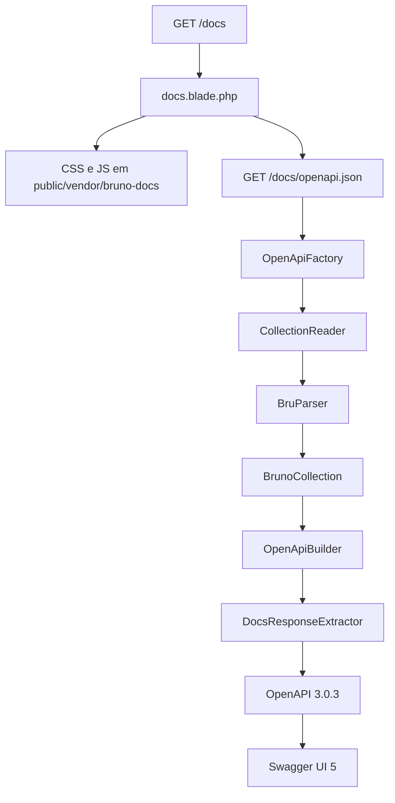

# Fluxo: coleção Bruno para Swagger

Os arquivos `.bru` continuam sendo a fonte. O pacote não os altera. Em cada pedido do spec ele lê a pasta da coleção, monta um documento OpenAPI 3.0.3 e o Swagger UI só renderiza esse JSON.



As classes ficam em `src/`. A página está em `resources/views/docs.blade.php`. O Swagger UI vendido está em `resources/swagger-ui/` e é publicado em `public/vendor/bruno-docs/`.

## 1. O pedido chega nas rotas

`BrunoDocsServiceProvider` registra duas rotas fora do grupo `api`, para não passar pelo middleware de token Bearer da API:

| Método | URL padrão | Nome | Método |
| --- | --- | --- | --- |
| `GET` | `/docs` | `bruno-docs.show` | `DocsController::show` |
| `GET` | `/docs/openapi.json` | `bruno-docs.spec` | `DocsController::spec` |

O prefixo vem de `bruno-docs.path`. As duas rotas usam o grupo `web` e `EnsureBrunoDocsAccess`. Essa middleware decide se a página é pública ou se exige sessão. Ela não participa da conversão.

`show` só confirma que a pasta da coleção existe e devolve a view com quatro dados: título, URL do spec, URL do CSS e URL do JS. A conversão acontece no segundo pedido, quando o navegador busca `openapi.json`.

## 2. O caminho da coleção

`BrunoDocsSettings::collectionPath()` lê `config('bruno-docs.collection')`. A aplicação precisa apontar isso para a pasta que contém `bruno.json`. Caminho vazio ou pasta inexistente lança `BrunoCollectionNotFoundException` com a mensagem `Bruno collection directory [(empty)] was not found.` quando o valor está vazio.

`OpenApiFactory::make()` repete essa checagem antes de ler qualquer arquivo.

## 3. Leitura da coleção

`CollectionReader::read()` percorre a pasta com `RecursiveDirectoryIterator` e junta os `.bru`, menos os de `environments/`.

Arquivos que não viram operação:

| Arquivo | Uso |
| --- | --- |
| `bruno.json` | Nome da coleção. Sem arquivo ou sem `name`, o título fica `API`. |
| `collection.bru` | Auth padrão. Só o `auth.mode` é lido. O bloco `auth:bearer` e o token `{{api_token}}` são ignorados. |
| `folder.bru` | Nome e `seq` da tag daquela pasta. |
| `environments/*.bru` | Servers. Só entra `vars.baseUrl` que comece com `http://` ou `https://`. `vars:secret` e `api_token` não são lidos. |

Cada outro `.bru` pode ter um bloco `get`, `post`, `put`, `patch`, `delete`, `head` ou `options`. Cada bloco presente vira um `BrunoRequest`:

| Campo do request | Origem |
| --- | --- |
| `name` | `meta.name`, ou o nome do arquivo |
| `sequence` | `meta.seq` |
| `method` | nome do bloco HTTP |
| `url` | `url` do bloco HTTP, ainda com `{{baseUrl}}` |
| `auth` | `auth` do bloco. `inherit` usa o `mode` de `collection.bru`. `none` vira ausência de auth |
| `docs` | bloco `docs` inteiro |
| `body` | bloco `body:json` só quando o bloco HTTP não diz `body: none` |
| `query` | bloco `params:query`. Sem esse bloco, a query string da URL |
| `tag` | nomes dos `folder.bru` no caminho, unidos com ` / `. Arquivo na raiz da coleção fica na tag `General` |

A ordem da tag usa o `seq` da primeira pasta. Pasta aninhada usa o `seq` do `folder.bru` mais fundo em `nestedSequence`.

`BruParser` corta o arquivo em blocos pelo cabeçalho `nome {` ou `nome [`. Chaves e colchetes aninhados, inclusive JSON, ficam dentro do bloco. `BalancedDelimiter` percorre aspas para não fechar o bloco no meio de uma string.

## 4. Montagem do OpenAPI

`OpenApiBuilder::build()` recebe a `BrunoCollection` e devolve o array do spec. `info.version` é sempre `1.0.0`. `info.title` usa o título da config quando ele não está vazio. Caso contrário usa o nome do `bruno.json`.

Os requests são ordenados por tag, pasta aninhada, `seq` do arquivo e nome. Cada um vira uma operation em `paths`.

### URL e path

`{{...}}` é removido da URL, então `{{baseUrl}}/api/medicaments` vira `/api/medicaments`. A query string sai do path e, se não houver `params:query`, vira parâmetro.

Um segmento que é um UUID vira parâmetro de path. O nome sai do segmento anterior, no singular quando ele termina em `s`. O UUID original fica no `example`.

`/api/medicaments/591c0377-08d0-4259-8cf3-015d901c2b4c` vira `/api/medicaments/{medicament}`.

### Query

Cada chave de `params:query` vira um parâmetro `in: query`.

- Linha com `~` continua no conjunto de valores, mas não é o exemplo. O exemplo usa o primeiro valor habilitado.
- A mesma chave com vários valores distintos vira `enum`.
- Chave terminada em `[]` vira `array` com `style: form` e `explode: true`.
- Valores só numéricos viram `integer`. Só `true` e `false` viram `boolean`. O resto fica `string`.

No fixture `tests/fixtures/collection/medicaments/list.bru`, `sort: NAME` com `~sort: COMPANY` e `~sort: RELEVANCE` produz `enum: [NAME, COMPANY, RELEVANCE]` e `example: NAME`. `take: 100` vira inteiro. `ids[]` repetido vira array de strings.

### Corpo

`body:json` precisa ser JSON válido. O valor decodificado vira `requestBody.content.application/json.example` e o `schema` é inferido: objeto, array, inteiro, número, booleano, string ou `nullable`. JSON inválido omite o `requestBody`. Multipart, formulário e texto não são lidos.

### Respostas a partir do bloco `docs`

O texto inteiro do bloco `docs` vai para `description` da operation. `DocsResponseExtractor` ainda procura linhas de status nesse texto:

```text
^[ \t]*(?:-[ \t]*)?(?:Resposta[ \t]+)?(\d{3})\b
```

Servem `200`, `Resposta 200` e `- 401`. O primeiro `{` ou `[` depois do status, se for JSON balanceado, vira `example`. O restante da linha e o texto até o próximo status ficam na `description` daquele código. Status repetido junta as descrições e guarda o primeiro exemplo.

Sem nenhuma linha de status, a operation recebe só `200` com a descrição `Successful response`.

No mesmo fixture de listagem, o bloco produz:

- `200`, descrição `Response 200` (a palavra `Resposta` é só o marcador e o JSON sai da prosa), exemplo `{"items":[...],"total":1}`
- `401`, descrição `Response 401`, exemplo `{"message":"Unauthenticated."}`
- `422`, descrição `quando take ou skip são inválidos`, sem exemplo

O schema de cada exemplo segue a mesma inferência do corpo.

### Auth e servers

`auth` igual a `bearer` coloca `security: [{ bearerAuth: [] }]` na operation e declara o scheme uma vez:

```json
{ "type": "http", "scheme": "bearer" }
```

O token não entra no documento. Auth `none` ou ausente não cria `security`.

Cada environment válido vira um item de `servers`, com `url` igual ao `baseUrl` sem barra no fim e `description` igual ao nome do arquivo. A ordem é `local`, `development`, `homolog`, `production` e, depois, os demais em ordem alfabética.

### operationId

O id é o método, a tag e o nome, em minúsculas, com qualquer sequência que não seja letra ou dígito trocada por `_`. Repetição ganha sufixo `_2`, `_3`. `PUT` na tag `Medicaments / Batch` com nome `Update` fica `put_medicaments_batch_update`.

## 5. Cache

Com `bruno-docs.cache` ligado, `OpenApiFactory` guarda o spec em `Cache::rememberForever`. A chave é `bruno-docs.` mais o SHA-256 de caminho relativo e `filemtime` de cada `.bru`, de cada environment e do `bruno.json`. Alterar um arquivo muda a chave. O valor antigo permanece no cache até outro mecanismo limpá-lo.

Com o cache desligado, `make()` lê a coleção e monta o spec em todo pedido.

## 6. O que o Swagger faz

A view carrega `swagger-ui.css` e `swagger-ui-bundle.js` como arquivos estáticos e chama `SwaggerUIBundle` com `url` apontando para `bruno-docs.spec`. O Swagger baixa o JSON, desenha a página e usa o `bearerAuth` só no Try it out. Ele não lê `.bru`.

## O que fica de fora

Scripts Bruno, asserts, testes, `vars:secret`, valores de `api_token`, auth que não seja `bearer`, body que não seja `body:json` e qualquer `baseUrl` que não seja HTTP ou HTTPS.
